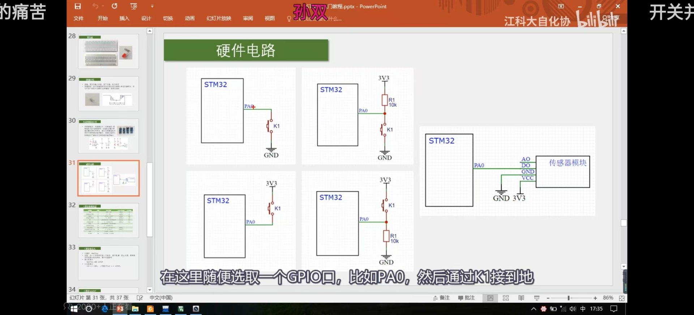

# GPIO 输入（按键）

**一句话：读引脚电平——按键接 GND 就配上拉，接 3V3 就配下拉，绝不能悬空。**

## 关键结论

| 接法 | GPIO 配置 | 松开读 | 按下读 |
|---|---|---|---|
| 按键接 GND（最常用） | **上拉输入** `IPU` | 1 | 0 |
| 按键接 3.3V | 下拉输入 `IPD` | 0 | 1 |

## 卡在哪

按了没反应，**拔插线反而变了** → 线接在电源脚或隔壁不通的列，绕过了按键 → 板子端必须插 GPIO 引脚，不是 G/3.3。

## 记住三条

1. 口诀：**另一头接地配上拉，另一头接 3V3 配下拉**；悬空一定读数乱跳
2. 四脚按键**同侧同组、异侧才开**——两脚接同一侧＝内部短路，按不按一样
3. 抖动 5~10ms，按键要消抖；`GPIO_ReadInputDataBit` 返回 `Bit_SET/Bit_RESET`

## 现象

按一下键，LED 翻一次。

---

<details>
<summary>备查：四个坑</summary>

| 坑 | 现象 | 原因 | 解决 |
|---|---|---|---|
| 悬空 | 读数乱跳 | 引脚没给确定电平 | 必须配上拉或下拉 |
| 抖动 | 按一次读成好几次 | 簧片弹跳 5~10ms | 加 20ms 延时确认，或改用中断 |
| 线绕过按键 | 手按没反应，拔插线反而变 | 线插在电源脚或隔壁不导通的列 | 插 GPIO 引脚 |
| 同侧取电 | 按了完全没反应 | 四脚按键两脚接了同一侧 | 两脚取异侧 |

</details>

<details>
<summary>备查：四脚按键怎么接</summary>



| 位置 | 关系 |
|---|---|
| ①—② / ③—④ | 内部常通，不用管 |
| 左右两组之间 | 按下通、松开断 ← **唯一有用的** |

| 接法 | 结果 |
|---|---|
| ①→GND，③→B1（跨侧） | ✅ 正确 |
| ①→GND，②→B1（同侧） | ❌ 永远接地 |
| ①②→GND，③④→B1（并联） | ✅ 也可以 |

面包板：四脚都插进孔固定，只需接对角两个（跨中间凹槽天然是异侧）。

</details>

<details>
<summary>备查：面包板规则 / 读输入函数</summary>

- 每列纵向 5 孔互通（中间凹槽分上下两半）
- 线要插在与元件脚同一列的孔，插隔壁列等于没接
- 电源轨中间是断开的：G 接哪半段，负载就得用哪半段

```c
GPIO_ReadInputDataBit(GPIOA, GPIO_Pin_0);   // 读单个引脚
GPIO_ReadInputData(GPIOA);                  // 读整个端口 16 位
```

模式选型：外电路已给确定电平→浮空；接 GND→上拉；接 3V3→下拉；模拟量→模拟输入（要 ADC）。

</details>

<details>
<summary>备查：按没反应时的排查顺序</summary>

```
按没反应
 ├─ ① 不碰线只按 → 有反应吗？
 │    ├─ 有 → 成功
 │    └─ 没 ↓
 ├─ ② 拔插线 → LED 变不变？
 │    ├─ 变 → 线绕过按键了
 │    └─ 不变 → 线没接通（虚接 / 插错列）
 └─ ③ 查两根线是不是同侧
```

</details>

<details>
<summary>备查：传感器模块 & 电位器替代</summary>


原理：敏感电阻随外界量变化 → 与定值电阻分压 → 模拟电压 → 比较器二值化 → DO 输出 0/1。

**实操（3-4 替代，已跑通）**：0932 立式电位器——两端接 3.3V/GND，**中间抽头接 PB1（浮空输入）**，转过阈值点 LED 亮。

- 两端接反无所谓，只是方向反过来；中间抽头必须接 GPIO
- 用**浮空**不用上拉：内部上拉会和下半段分压，扭曲读值
- 踩坑：main 忘写 `KeyNum = Key_GetNum();` → 永远 0，编译 0 Error 也不响应

</details>

<details>
<summary>备查：C 语言四个工具</summary>

| 工具 | 关键字 | 一句话 | 库里的例子 |
|---|---|---|---|
| 宏定义 | `#define` | 字符串替换，改一处全生效 | `#define GPIO_Pin_13 ((uint16_t)0x2000)` |
| 类型重命名 | `typedef` | 长类型名起短名 | `typedef unsigned char uint8_t;` |
| 结构体 | `struct` | 不同类型打包 | `GPIO_InitTypeDef` |
| 枚举 | `enum` | 限定取值范围的整数 | `FunctionalState = {DISABLE, ENABLE}` |

结构体用 `变量.成员`，指针用 `->`——所以 `GPIO_Init(GPIOA, &GPIO_InitStructure)` 要取地址。

</details>

<details>
<summary>备查：和 3-1 输出的一行区别</summary>

输出：CPU 写 ODR/BSRR → 引脚；输入：引脚 → 施密特触发器 → IDR → CPU 读。两条通路独立，可同时工作。

</details>
