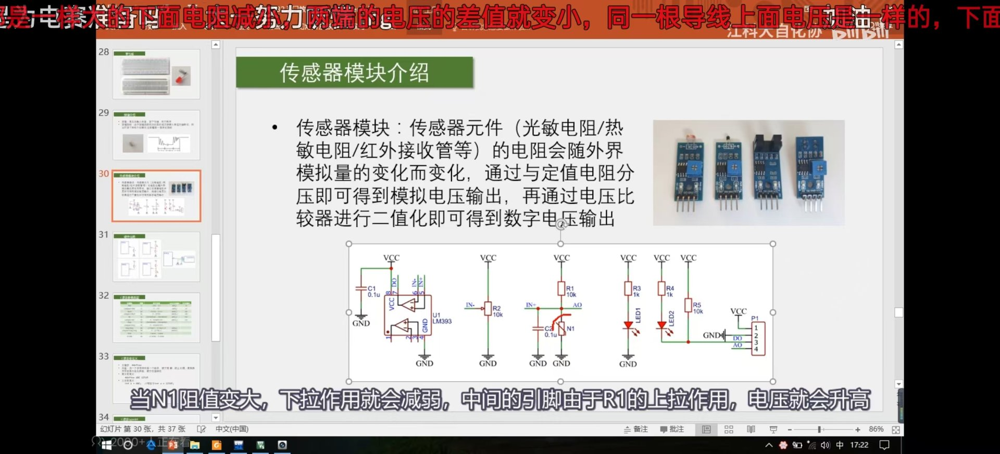

# GPIO 输入（理论学习）

## 踩坑预警

- 按键抖动 5~10ms：一次按下会被读成好几次，要么加 20ms 延时确认，要么 5-1 用中断处理
- 悬空引脚读数乱跳：**输入引脚必须配上拉或下拉**，按键接 GND 就配上拉

## 按键输入（重点）


| 接法 | GPIO 配置 | 松开读 | 按下读 |
|---|---|---|---|
| 按键接 GND（最常用） | 上拉输入 | 1 | 0 |
| 按键接 3.3V | 下拉输入 | 0 | 1 |

**判断口诀：另一头接地配"上拉"，另一头接 3V3 配"下拉"。**


## 读输入的两个函数

```c
GPIO_ReadInputDataBit(GPIOA, GPIO_Pin_0);   // 读单个引脚：Bit_SET / Bit_RESET
GPIO_ReadInputData(GPIOA);                  // 读整个端口 16 位
```

输入模式选型：外电路已给确定电平 → 浮空；按键接 GND → 上拉；接 3V3 → 下拉；接模拟量 → 模拟输入（直通 ADC，GPIO 读不了）。

## 传感器模块



原理一句话：**敏感电阻随外界量变化 → 和定值电阻分压 → 得到模拟电压 → 比较器二值化 → 数字输出 DO**。

光敏传感器（3-4）：**未买，跳过实操，原理已懂**——光照强 → 电阻变小 → 分压点电压变高，比较器和电位器设定阈值后 DO 输出 0/1，GPIO 读 DO 就行（和读按键完全一样）第 4 周用 ADC 读 AO 拿到连续光照值。


## C 语言四个工具（读标准库必需）

| 工具 | 关键字 | 一句话 | 库里的例子 |
|---|---|---|---|
| 宏定义 | `#define` | 字符串替换数字，改一处全生效 | `#define GPIO_Pin_13 ((uint16_t)0x2000)` |
| 类型重命名 | `typedef` | 长类型名起短名 | `typedef unsigned char uint8_t;` |
| 结构体 | `struct` | 不同类型变量打包 | `GPIO_InitTypeDef`（Pin/Mode/Speed 三件套） |
| 枚举 | `enum` | 限定取值范围的整数集合 | `FunctionalState = {DISABLE, ENABLE}` |

结构体两种访问：`变量.成员`；**指针用 `->`**——这就是为什么 `GPIO_Init(GPIOA, &GPIO_InitStructure)` 里要取地址再传指针。

## 和 3-1 输出的区别（一行）

输出：CPU 写 ODR/BSRR → 引脚；输入：引脚 → 施密特触发器 → IDR → CPU 读。输入输出通路独立，可同时工作。
