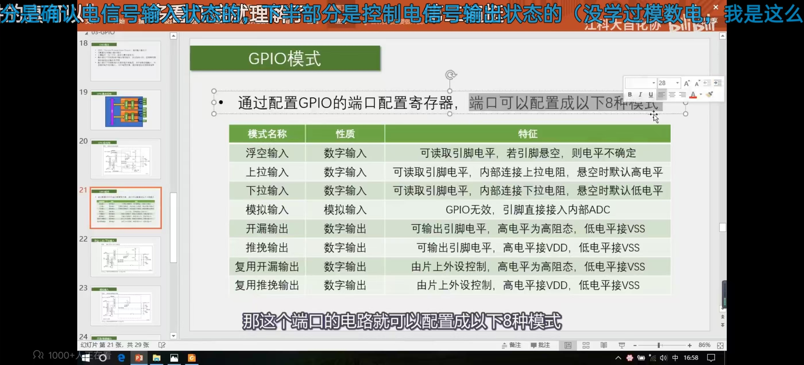
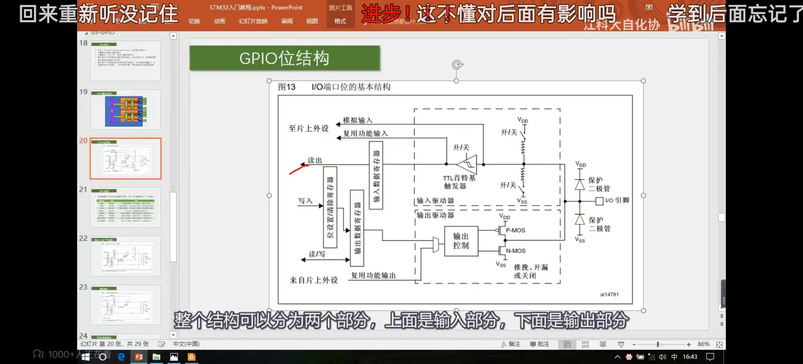

# 3-1 GPIO 输出

**一句话：让引脚输出高低电平——点灯选推挽，改电平用 BSRR 原子写。**

## 关键结论

| 项 | 值 |
|---|---|
| 挂哪条总线 | APB2，`RCC_APB2PeriphClockCmd` |
| 点灯用哪个模式 | 推挽输出 `GPIO_Mode_Out_PP` |
| 改电平用哪个函数 | `GPIO_SetBits` / `GPIO_ResetBits` |

## 卡在哪

暂无（这节是理论，没踩坑）。

## 记住三条

1. `SetBits/ResetBits` 底层写 **BSRR**，是原子操作；`ODR |= (1<<13)` 是读-改-写，中断里别用
2. 8 种模式日常只用 4 个：上拉输入、下拉输入、推挽输出、开漏输出
3. 输出只有 ±20mA 级别，LED 必须串 1k，蜂鸣器/电机要过三极管

## 现象

PC13 的 LED 按时闪烁。

---

备查：8 种模式与使用场景

| 模式 | 一句话 | 什么时候用 |
|---|---|---|
| 上拉输入 | 悬空默认高电平 | **按键接 GND 时用它** |
| 下拉输入 | 悬空默认低电平 | 按键接 3.3V 时用它 |
| 推挽输出 | 能主动输出高/低，驱动能力强 | 点灯、驱动大部分东西，**默认选它** |
| 开漏输出 | 只能拉低，高电平靠外部上拉 | I2C 必须用（MPU6050 会遇到） |
| 模拟输入 | GPIO 无效，直通 ADC | 采电压/温度 |
| 复用推挽/开漏 | 引脚交给片上外设管 | PWM 输出、串口 TX |

备查：位结构与一页速记

- GPIO 挂 **APB2**，每个 GPIOx 管 16 个脚（PA0~PA15），F103C8T6 共 37 个 I/O
- 电平 0~3.3V，只有标 **FT** 的引脚能接 5V
- 位结构：上=输入（施密特触发器读），下=输出（P-MOS/N-MOS）
- 硬件注意：LED 必须串限流电阻；驱动蜂鸣器等大电流器件要先用 S8050 三极管

