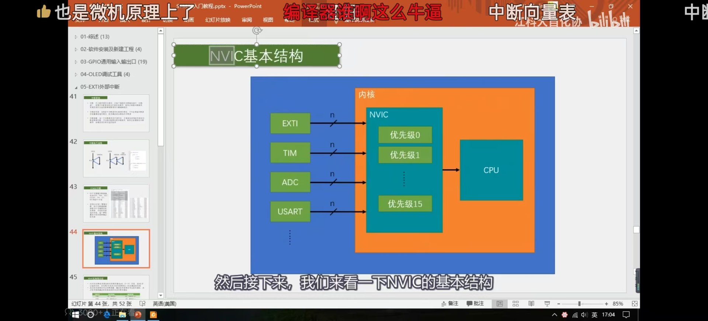
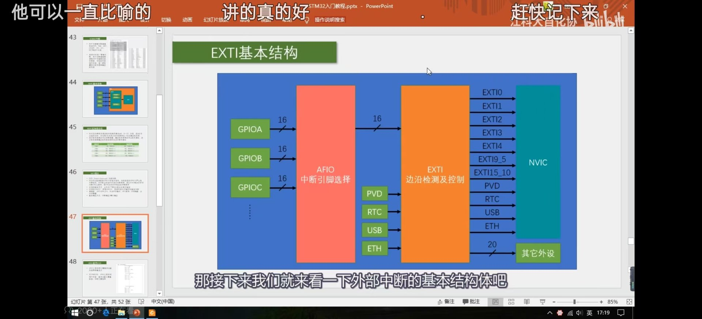
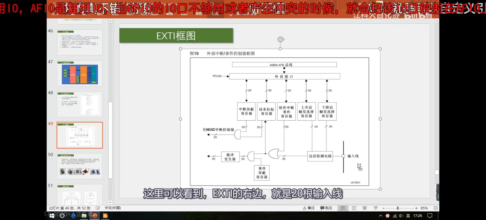

# 5-1 EXTI 外部中断

## 一、中断是什么

| 概念 | 一句话 |
|---|---|
| **中断** | 主程序运行中，触发条件出现 → CPU 暂停 → 去处理中断程序 → 处理完回来接着跑 |
| **中断优先级** | 多个中断同时申请，按轻重缓急裁决，先响应更紧急的 |
| **中断嵌套** | 中断程序跑到一半，更高优先级的来了 → 再暂停 → 处理完依次返回 |

**为什么用中断**：轮询是 CPU 死循环问"按键按了没"；中断是 CPU 该干嘛干嘛，硬件自动叫它。**省 CPU、响应快。**

## 二、STM32 的中断体系

| 项 | 值 |
|---|---|
| 中断通道（中断源） | 68 个可屏蔽（EXTI/TIM/ADC/USART/SPI/I2C/RTC 等） |
| 管理者 | **NVIC**（内核内），所有中断先经它裁决再到 CPU |
| 优先级 | 每通道 16 级（0~15），**数字越小越优先** |

## 三、抢占 vs 响应

优先级这 4 位拆成两段：**高位 = 抢占优先级，低位 = 响应优先级**。

| | 抢占优先级高 | 响应优先级高 |
|---|---|---|
| 中断正在跑时能插队吗 | **能**（中断嵌套） | 不能，只能等 |
| 同时申请谁先上 | 抢占优先的先 | 响应优先的先 |
| 完全相同时 | 按中断向量表编号排队 | |

**一句话**：抢占 = 能打断别人；响应 = 只能排队。

## 四、EXTI 外部中断

| 项 | 说明 |
|---|---|
| 功能 | 监测指定 GPIO 的电平变化 → 向 NVIC 申请 → CPU 执行中断函数 |
| 触发方式 | 上升沿 / 下降沿 / 双边沿 / 软件触发 |
| 支持 | 所有 GPIO，但**相同 Pin 号不能同时用**（PA0 和 PB0 只能选一个） |
| 通道数 | 16 个 GPIO_Pin + PVD/RTC/USB/ETH = 20 条输入线 |

### 结构：哪根线怎么接到 EXTI

**AFIO 的作用**：GPIOA/B/C 的 Pin0 都想触发 EXTI0，但 EXTI0 只有一根线，AFIO 负责"16 选 1"。**这就是 PA0/PB0 不能同时中断的原因。**

### 数据流：信号进来后经过什么

边沿检测 → 选触发方式（与门）→ 屏蔽寄存器 → **挂起寄存器** → NVIC

> **挂起寄存器最关键**：它记录"哪个中断发生了还没处理"。中断函数里忘了清标志位，程序会反复进出中断

## 五、中断函数写在哪

写在 `User/stm32f10x_it.c`，**函数名必须和启动文件 `startup_stm32f10x_md.s` 里的向量表完全一致**（如 `EXTI0_IRQHandler`），差一个字母中断永远不进。

## 六、和轮询的对比

| 轮询（3-3） | 中断（5-1） |
|---|---|
| main 里死循环读 GPIO | 主程序该干嘛干嘛 |
| 响应慢、CPU 全程盯 | 按下瞬间硬件自动跳进中断函数 |
| 逻辑简单好调试 | 响应快，但要清标志位 |

**5-1 实操步骤**：GPIO 上拉 → 配 EXTI 触发沿 → 开 AFIO 时钟 + 选线 → 配 NVIC 分组优先级 → 写中断函数。

---

备查：优先级分组对照表 / 事件响应

**五个分组**：

| 分组 | 抢占优先级 | 响应优先级 |
|---|---|---|
| 分组 0 | 0 位（=0） | 4 位（0~15） |
| 分组 1 | 1 位（0~1） | 3 位（0~7） |
| **分组 2** | **2 位（0~3）** | **2 位（0~3）** |
| 分组 3 | 3 位（0~7） | 1 位（0~1） |
| 分组 4 | 4 位（0~15） | 0 位（=0） |

**事件响应**：不进 CPU，直接给其他外设发脉冲（如触发 TIM 计数、ADC 启动）。省 CPU 但用途少，知道有这回事即可。

